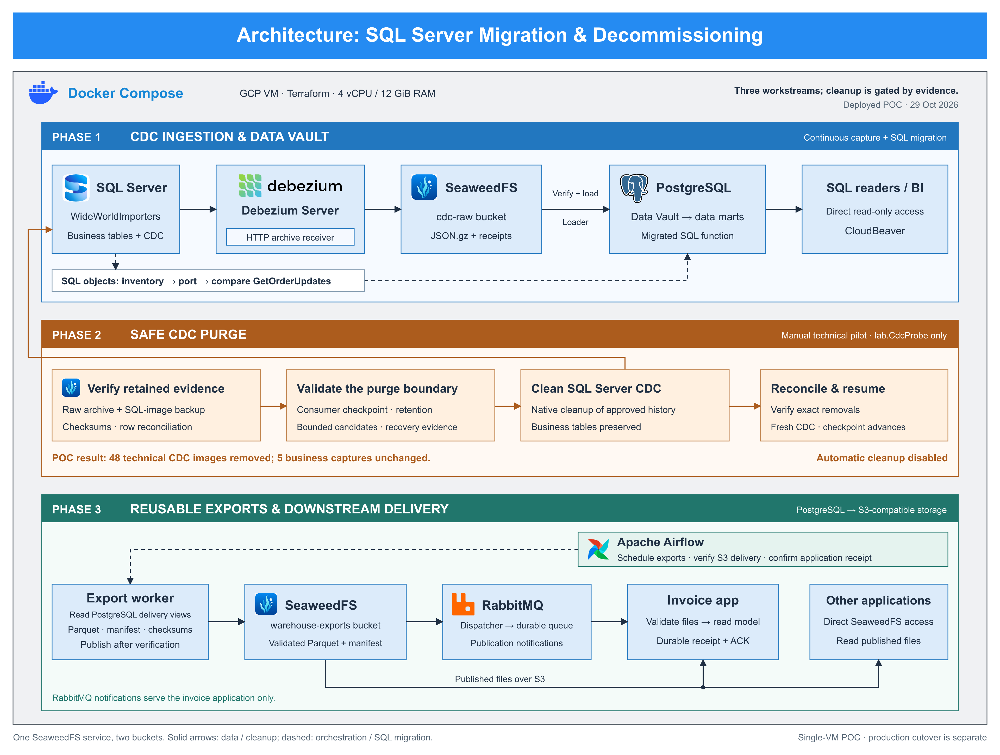

# SQL Server migration and decommissioning lab

A completed proof of concept for moving a SQL Server application data path to Docker-hosted services: CDC ingestion, a PostgreSQL Data Vault, controlled CDC cleanup, and reusable Parquet delivery.

The lab runs on a Terraform-managed Linux GCP VM with 4 vCPUs and 12 GiB RAM. GCP supplies the VM and disks; all data services run in containers. SQL Server Developer is the proprietary source. There is no managed Redshift or Amazon S3 service, Kafka broker, Kafka Connect deployment, dbt, or Spark in this implementation.



## Three workstreams

| Workstream | Implementation | Validated scope |
| --- | --- | --- |
| 1. Capture and migrate | SQL Server → Debezium Server HTTP sink → verified SeaweedFS archives → PostgreSQL Data Vault and business views | Five business tables, 604,445 current rows reconciled on the declared projections; one stored procedure ported and compared |
| 2. Audit and purge | Read-only readiness audit, separate manual cleanup pilot, retained evidence and connector recovery checks | 48 old CDC images from `lab.CdcProbe` removed; five business capture histories unchanged |
| 3. Deliver to applications | Versioned export contracts → verified Parquet files → publication record → downstream consumers | 228,265 invoice lines and 231,412 order lines; one invoice application notified through RabbitMQ |

Other applications read PostgreSQL or SeaweedFS directly. RabbitMQ is used by one billing demonstration application. Airflow orchestrates finite export and validation jobs; capture, warehouse loading, notification dispatch and application consumption remain continuous services.

## What the POC proved

During controlled SQL Server outages, the migrated procedure reproduced seven comparison cases, the independent S3 consumer verified order data, and a new invoice export was delivered and reconciled in the application. SQL Server and Debezium were then restarted and new insert/update/delete capture was verified. The [closure report](docs/validation/poc-closure-v1-2026-10-29.json) records both outage windows, an initial SQLite observer failure, its correction, and the final results.

These are historical lab observations from October 2026, not current service-health claims. The source was restored at the end. Permanent production retirement, high availability, off-VM recovery, business CDC cleanup and migration of every application dependency are outside the completed POC scope.

**Automatic CDC cleanup remains disabled.** The readiness audit always returns `purge_authorized=false`. The separate [manual technical pilot](services/purge/README.md) does not authorize business purges. An archive object, maximum LSN, or consumer acknowledgment alone is insufficient authorization to delete source history.

## Start here

Read [Getting started](docs/GETTING_STARTED.md) before deploying. This repository is the validated lab implementation, not a certified one-command installer for a fresh environment. Snapshot identities, initial source positions, reference versions and the exact cleanup image binding must be established for your installation. Do not copy historical LSNs or rewrite migrations in an already deployed database.

| Component | Runbook |
| --- | --- |
| Terraform VM, disk, IAP and OS Login | [Infrastructure](infra/README.md) |
| WideWorldImporters restore and source CDC | [SQL Server](services/sqlserver/README.md) |
| Debezium, signed HTTP ingestion and SeaweedFS archives | [CDC](services/cdc/README.md) |
| Data Vault, business views, reconciliation and procedure migration | [Warehouse](services/warehouse/README.md) |
| Reusable export contracts and independent S3 consumer | [Exports](services/export/README.md) |
| Dispatcher and one billing consumer | [RabbitMQ](services/rabbitmq/README.md) |
| Export scheduling, validation and retry identity | [Airflow](services/airflow/README.md) |
| Audit, recovery evidence and technical cleanup | [Purge](services/purge/README.md) |
| Database browser and service interfaces | [CloudBeaver](services/cloudbeaver/README.md) |

The [SQL object catalog](docs/migration/sql-object-catalog-2026-10-28.json) classifies 42 stored procedures and their declared dependencies. The pilot ports `Integration.GetOrderUpdates` to `app.get_order_updates(text,text,text)` and loads its 14-row package-type dependency as an explicitly versioned reference. CDC does not translate stored procedures or replace application dependency discovery.

## Access the interfaces

With an initialized Terraform checkout, run:

```bash
bash infra/scripts/ui-tunnel.sh
```

Alternatively, set `LAB_PROJECT`, `LAB_VM` and `LAB_ZONE` explicitly. The script uses IAP and binds forwarded ports only to local loopback.

| Interface | Local address |
| --- | --- |
| CloudBeaver | http://localhost:8978/ |
| Airflow | http://localhost:8080/ |
| RabbitMQ management | http://localhost:15672/ |
| SeaweedFS filer | http://localhost:8888/ |
| SeaweedFS master | http://localhost:9333/ |

Credentials are generated on the VM and read from protected files by the installers. They are not included in the repository. Follow the corresponding runbook to access them.

## Repository contents

`infra/` contains Terraform, its provider lock file and bootstrap scripts. `services/` contains Docker builds, Compose configuration, application code, SQL migrations, contracts and tests. `scripts/` contains the deliberate POC closure exercise. `docs/decisions/`, `docs/migration/` and `docs/validation/` retain the contracts, dependency inventory and sanitized acceptance evidence referenced by the runbooks.

Local secrets, generated environments, Terraform state and plans, service volumes, database backups, raw archives, connector state, caches, ZIP packages, Medium drafts, screenshots and obsolete diagrams are excluded. Only the current architecture and its [logo attribution](docs/architecture-assets/sources-v7-en.json) are included.

## Validation and limits

Test code is retained alongside each service. Read each runbook before running integration tests: some require provisioned services, create technical probes or temporarily stop containers. The local Airflow unit suite can run without the VM:

```bash
python3 -m unittest discover -s services/airflow/tests -v
```

Historical acceptance reports describe the exact tested scope and failures; they are not results from your new installation. Source images and dependencies are pinned where configured. No production capacity or recovery guarantee follows from this small fixture.

The [project rules](AGENTS.md) describe the required operational practices. Existing third-party software and logos retain their respective licenses and ownership; SQL Server Developer is for development and testing.
